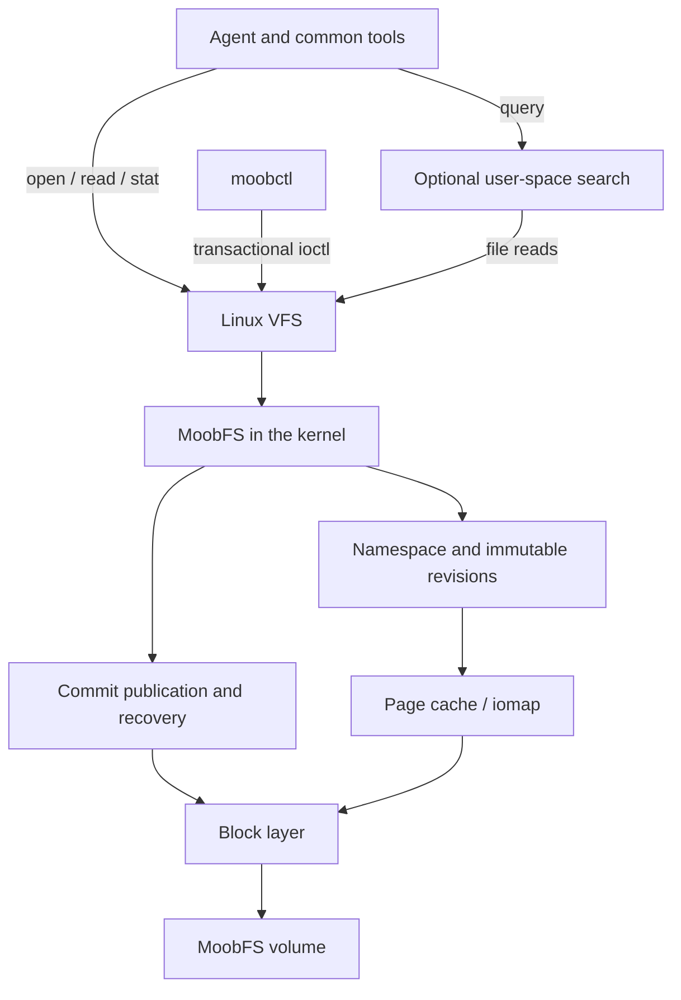

# MoobFS: native MVP on Linux

Date: October 10, 2026. Status: architecture proposal, no implementation.

## 1. Goal and scope

Build a block filesystem that Linux mounts as type `moobfs`, implemented by a loadable module `moobfs.ko`. It must store persistent memories, share identical content and expose stable versions as conventional files. The module serves reads directly through the VFS; there is no FUSE or mandatory service in the read path.

The complete MVP must accept new memories while mounted and recover them after reboot. A read-only image will be the first technical deliverable, not the end of the MVP.

Initial decisions:

| Aspect | Decision |
| --- | --- |
| Implementation | External module in C and user tools in C; tests may use Python/shell. |
| Environment | Linux x86-64 VM, 4 KiB pages, kernel and configuration pinned before the first build. Record exact version, commit, configuration and compiler. |
| Device | One local block device; image file with loop for basic tests and a dedicated virtual disk for failures. |
| Content unit | Object of up to 64 KiB, identified internally by ID and searchable by the hash of its bytes. |
| Writing | Transactional publication of objects/revisions/snapshots; one commit at a time per volume. |
| Reading | `open`, `read`, `pread`, `stat`, directory enumeration and `lseek` on immutable files. |
| Sharing | Whole identical objects, without text normalization. |
| History | Immutable revisions and snapshots, preserved for the whole life of the v0 volume. |
| Permissions | One trust domain per volume; owner defined at mount. No isolation between agents in v0. |

Not part of v0: arbitrary POSIX editing, `mmap`, direct I/O, user-created hard links, standard reflink ioctl, deletion, garbage collection, compression, network, ACLs, simultaneous mount on different machines or semantic processing in the kernel. An unsupported operation must fail explicitly.

## 2. Architecture



The module implements registration with the VFS, mount, inodes, directories, reading, transactional control and access to the block device. It uses the existing disk drivers.

The optional search service keeps rebuildable indexes outside the volume, for example in SQLite. It can select memories and assemble context, but it does not take part in an ordinary read and is not needed to mount or recover the filesystem. Content and origin persist in MoobFS.

The integration will be based on the mount API with `fs_context`, the page cache with folios and read mapping by `iomap`. The concrete signatures will be checked in the code of the pinned kernel, since documentation of different versions does not replace compiling against that target.

## 3. Data model

| Entity | Conceptual fields |
| --- | --- |
| Object | `object_id`, SHA-256, original size, payload location. |
| Memory | `memory_id`, number of the last confirmed revision. |
| Revision | `memory_id`, `revision`, `object_id`, opaque metadata, publication instant. |
| Snapshot | `snapshot_id`, ordered list of `(memory_id, revision)` pairs. |
| Transaction | `request_id`, generation, result, records and final confirmed boundary. |

IDs are 64-bit integers, relative to the volume UUID. Confirmed IDs are never reused. The hash is not used as an inode or as the sole proof of equality.

```text
Memory 41, revision 1 ─┐
                      ├─ object 18 ─ payload in the volume
Memory 72, revision 1 ─┘

Memory 41, revision 2 ─── object 25 ─ another payload
```

On insertion, the module computes SHA-256, looks up candidates by hash and size and compares their bytes. It only reuses an object after exact equality. A hash collision with different bytes creates another `object_id` in the same candidate group.

Origin, classification and other information live in the revision, not in the shared object. The module accepts up to 4 KiB of opaque metadata per revision; the CLI presents it as UTF-8 JSON. The kernel validates size and framing, it does not interpret JSON or natural language. Content text is preserved as bytes, including differences in whitespace and line breaks.

The snapshot pins at most one revision per memory. It copies references, not the objects' data. Constant-time snapshots are not promised: the initial manifest is a list and its cost is proportional to the number of entries.

## 4. Namespace and read semantics

Illustrative example, not yet existing:

```text
/mnt/moob/
  .control
  memories/
    41/
      revisions/
        1/
          content
          metadata.json
        2/
          content
          metadata.json
  snapshots/
    9/
      manifest
      memories/
        41/
          content
          metadata.json
```

`content` contains exactly the published bytes. `metadata.json` contains the metadata of that revision; the CLI requires valid JSON, although the filesystem treats it as bytes. `manifest` is a deterministic representation of the set pinned by the snapshot.

Each published file has a stable inode during the life of the volume. Allocation of inodes and IDs is part of the transaction; do not use the truncated hash to produce them. The snapshot record reserves the inodes needed for its entries.

Opening a revision pins its identity; a new publication does not change the open file. v0 does not expose a `latest` file whose content changes. To discover the current revision, the CLI queries the control file or lists revisions.

Content files are immutable, with a logical size equal to the original size. On-disk alignment bytes do not appear on read. Reads past the end return EOF.

Different files that reference the same object may have separate inodes and cache pages. Deduplication on disk does not imply deduplication in RAM. Also sharing the cache is not a goal of v0.

New entries must invalidate the corresponding negative dentries. Directories use enumeration cookies based on stable IDs. A concurrent enumeration may require a new call to find newly published entries; a snapshot keeps content fixed. Publication in the lookup index is atomic with respect to readers.

## 5. Write interface

`.control` is a control file of the filesystem itself. On a writable mount, the CLI opens it with write access and uses specific ioctls; the module checks descriptor mode, owner and mount state. An `ro` mount rejects any mutation with `EROFS`. Mutating operations take part in the VFS writer control, to coordinate freeze, read-only remount and unmount; checking only a local flag is not sufficient.

| Proposed operation | Contract |
| --- | --- |
| `GET_INFO` | UUID, format/UAPI version, limits, generation and usage counters. |
| `PUT` | Creates a memory or a new revision; receives content, metadata, `expected_revision` and `request_id`. Returns the IDs and the confirmed generation. |
| `SNAPSHOT` | Publishes an explicit list of existing revisions, with `request_id`. |
| `GET_REQUEST` | Retrieves the durable result of an operation by `request_id`. |

Creation uses `memory_id=0` and `expected_revision=0`. Update requires a match with the current revision; a conflict returns `EAGAIN`. Each PUT publishes a single memory. Atomic update of several memories is out of v0; a snapshot can gather already existing revisions.

The `request_id` is a 128-bit identifier generated by the CLI and persisted with the result. Repeating the same operation with the same key returns the original result; reusing the key with a different input returns `EINVAL`. The comparison of the input must be exact, not just a hash. This resolves the situation in which the commit completes but the response to the process is lost.

The arguments will have fixed-width integers, explicit alignment, zeroed reserved fields and bounded buffer descriptors. Larger texts are copied from user buffers, not embedded in the structure that encodes the ioctl number. Each request is copied and validated before its publication; do not keep reading mutable user memory during the commit.

The numbering and binary layout of the UAPI are implementation deliverables. An incompatible change requires a new command, without silently reinterpreting a published command. An unknown command returns `ENOTTY`.

POSIX writing via `write`, arbitrary truncation, creation and renaming are not supported in v0. Therefore, mounting and reading with common tools works, but saving with a conventional editor is not part of this MVP. The CLI does not replace the filesystem: all persistence continues to be done by the module on the native volume.

## 6. On-disk format v0

Format block: 4 096 bytes; little-endian integer fields; 64-bit offsets and lengths. The format will have explicit serialization, without depending on the padding of C structs. Metadata checksums use CRC32C; content uses SHA-256. M0 must specify exactly the coverage of each checksum, its field zeroed during computation and test vectors shared by the tools and the module.

```text
block 0      Static superblock A
block 1      Static superblock B
block 2      Checkpoint A
block 3      Checkpoint B
block 4...   Log of records and payloads
```

The superblocks contain magic, version, UUID, volume size, block size, compatibility flags and checksum. If the two valid copies diverge in identity/configuration, the mount fails.

Each checkpoint contains generation, exclusive boundary of the confirmed log, reference to the last COMMIT, next IDs and checksum. The two positions alternate on each commit; 4 KiB is not assumed to be atomically writable.

Records have type, length, transaction, IDs and checksum. Initial types: `OBJECT`, `REVISION`, `SNAPSHOT` and `COMMIT`. The COMMIT frames the records of the transaction, its predecessor and its idempotent result. References may only point to earlier confirmed records or ones belonging to the same transaction.

New headers and payloads start at block boundaries. Payloads have zeroed padding and an explicit original size. A transaction never modifies the last block of a confirmed transaction. This simplifies durability and reading by extents, but wastes space for small memories; measuring this cost is mandatory. Packing of small objects may change the format in a future version.

The catalog by ID and the hash index are rebuilt in RAM at mount, walking the records up to the selected checkpoint. Payloads are skipped according to validated lengths. Mount time is proportional to history and the index consumes RAM proportional to the number of records; it is not an unbounded-scale solution.

Metadata checksums are verified on replay. The offline verifier reads all payloads and validates SHA-256. v0 does not promise integrity verification of all data on every normal read through the cache: data checksums in the read path are a separate extension.

## 7. Publication and durability

A per-volume mutex serializes commits. Readers use immutable structures and appropriate synchronization to access the published generation. All memory needed for the index of a new transaction is reserved before starting its durable publication.

Proposed sequence:

1. Copy and validate the request; resolve idempotence and conflicts.
2. Reserve IDs, log space and memory for the publication. Reject `ENOSPC` before changing the confirmed state.
3. Write new objects, revision or snapshot and the COMMIT record in the log suffix; wait for completion and check errors.
4. Force persistence of the previous writes using the flush guarantees of the block layer.
5. Write the checkpoint of the new generation in the alternate slot with a persistence guarantee, using FUA/flush according to the block layer. Wait for its completion.
6. Publish the new generation in the in-RAM indexes, update/invalidate the necessary VFS entries and return success.

The previous checkpoint and all confirmed records remain preserved during this sequence. The oldest checkpoint slot can be replaced because the other one contains the complete previous generation.

Success of PUT/SNAPSHOT means a durable commit, assuming the storage stack honors flush/FUA. `close` is not the commit point. Since there is no buffered file editing, `fsync` is not needed to complete a successful PUT. `syncfs` must coordinate with commits in progress and propagate persistent errors.

If an I/O error occurs after writing has started, block new mutations and mark the mount as aborted for writing, keeping reads of the published state when possible. Do not overwrite the uncertain suffix on new attempts in the same mount. An error or interruption may leave the result undetermined for the caller; remounting and `GET_REQUEST` resolve whether the request was confirmed.

Recovery:

- Validate the superblock copies and both checkpoints.
- Choose the checkpoint of highest generation whose own checksum and structure are valid.
- Validate the confirmed log and all metadata references up to its boundary.
- If a valid checkpoint points to corrupted metadata, fail the mount, without hiding the problem by silently reverting to an old generation.
- If the write of the newest checkpoint was interrupted and its checksum is invalid, use the previous valid checkpoint.
- Ignore records after the confirmed boundary; that suffix may be reused after recovery.
- Rebuild indexes, request results and counters from the chosen state.

Checksums detect tears/corruption with high probability, but are not a mathematical proof of atomicity. There is no recovery from permanent hardware defects through payload redundancy in v0.

## 8. Limits and operation

Proposed limits to keep the experiment controlled: volume of up to 16 GiB, payload of up to 64 KiB, metadata of up to 4 KiB and snapshot with up to 4 096 references. The mount limits the in-RAM index to 256 MiB; a publication that exceeds the budget is rejected. An image whose replay exceeds this limit fails the mount in a controlled way with a memory error. These are MVP ceilings, not capacities already measured.

Without deletion or garbage collection, the volume eventually fills up. Historical references are not freed. Removing a memory from a future snapshot does not erase earlier content. Do not promise forgetting or physical erasure in this format.

The default mount does not allow executing binaries or interpreting devices/setuid from the volume. The mount owner reads and publishes memories; other users have no access by default. The metadata format does not replace permissions checked by the VFS. v0 does not support user namespaces or NFS export.

The module obtains appropriate exclusive access to the mounted device. `mkfs` and image importers only act on unmounted devices. User tools do not directly change a mounted volume.

## 9. Components and deliverables

Future structure, not yet implemented:

```text
include/uapi/       contract between module and tools
include/format/     on-disk layout and constants
kernel/            mount, inode, directories, read, log, commit, ioctl
tools/             mkfs.moobfs, moobctl, fsck.moobfs
tests/             format, mount, concurrency, recovery, benchmarks
vm/                reproducible configuration of the test Linux
```

`mkfs.moobfs` creates an empty volume; an offline import option helps produce the first image. `moobctl` publishes, inspects and creates snapshots through the mount. `fsck.moobfs` starts as a read-only verifier: it validates lengths, checksums, references and content, without repairing automatically.

| Stage | Deliverable | Exit criterion |
| --- | --- | --- |
| M0 | Kernel/configuration pinned, serialized format and offline tools. | Deterministic images are verified; invalid images are rejected. |
| M1 | Module mounts an `ro` image, lists and reads. | Correct bytes, correct limits and no memory/locking warnings in the tests. |
| M2 | Persistent PUT with revision and deduplication. | Publication during mount, two references to the same object, conflict detected and recovery after restart. |
| M3 | Snapshots, idempotence and failures. | Snapshots preserved, repeated requests do not duplicate commits and failures do not expose partial state. |
| M4 | Benchmark and a simple integration with an agent. | Report separates I/O cost, space and memory retrieval quality. |

M3 completes the functional core of the filesystem. M4 completes the evaluation of the MVP for use as LLM memory. It is not necessary to add embeddings to conclude the initial evaluation; lexical search and filtering by snapshot are an explicit baseline.

## 10. Validation

Correctness and recovery are exit requirements, not optional activities after optimizing:

1. Write identical bytes into two memories: check different memory IDs, the same `object_id`, correct logical size and real space growth only for the necessary metadata/padding.
2. Publish a different revision: the previous memory, the already open descriptor and the old snapshots keep returning the same bytes.
3. Publish after a lookup of a nonexistent entry: a new open finds the created entry, without a persistent negative dentry.
4. Contend for the same expected revision with two clients: only one wins; the other receives a conflict. Readers never see a partial revision.
5. Interrupt before/after each commit step: the recovered result is the complete old or complete new. Every success observed by the client persists after recovery.
6. Lose the response after persistence: repeating the `request_id` returns the original result without a new revision.
7. Inject partial write, read error, flush error and lack of space. Do not replace errors with success; abort new writes when the durable state is uncertain.
8. Mount images with excessive lengths, overflow, repeated IDs, references outside the volume or invalid checksums: controlled failure, without a kernel crash.
9. Force collisions in the deduplication index in tests: byte comparison prevents sharing different contents.
10. Run on a kernel with KASAN and lockdep for the correctness tests; use a separate documented configuration for performance.

Powering off a VM or using loop does not by itself demonstrate resistance to power loss: host caches may preserve data. The test must control/inject reordering, loss and tears in the block layer and verify the flush semantics of the virtual stack used. The `dm-log-writes` target can record the persistence order for replay, complemented by injection of errors and tears. Tests on physical storage come later.

## 11. Measurements and decision criteria

Compare on the same Linux, device and cache configuration:

- Mounted MoobFS.
- Conventional files on ext4, with the same memories and revisions.
- To evaluate usefulness for the agent, the same search, the same model, the same tokenizer and the same token budget on both paths.

Initial sets: 10 thousand and 100 thousand memories, sizes of 1, 4 and 16 KiB, repetition rates of 0%, 50% and 90%, with 1 and 8 concurrent readers. Record failures due to limits, instead of excluding configurations that do not fit.

Measure p50/p95/p99 of open+read and of `pread` with an already open descriptor, operations/s, CPU, module RAM, page cache, durable PUT latency, mount/replay time and total allocated space including metadata, padding and auxiliary indexes. Separate warm and cold cache; describe exactly which caches were emptied.

In the agent test, measure retrieval of the correct revision, cited origin, tokens delivered and time to assemble the context. The model's ability to understand a text does not change because it is in a native filesystem.

There is no invented speed target. First measure the baseline. The decision to evolve depends on demonstrating a benefit of sharing/versioning at an acceptable cost in the real flow; if the format wastes more space than it saves or reading becomes dominated by metadata, revise the layout before expanding features.

## 12. Technical references

The model and format decisions above are MoobFS proposals. The references below ground the Linux mechanisms; they do not prove the project's performance.

- [VFS](https://docs.kernel.org/filesystems/vfs.html): filesystem integration, inodes and operations.
- [Mount API](https://docs.kernel.org/filesystems/mount_api.html): context and creation of the mounted tree.
- [iomap](https://docs.kernel.org/filesystems/iomap/design.html): mapping and I/O infrastructure.
- [New filesystems](https://docs.kernel.org/filesystems/adding-new-filesystems.html): interfaces and tooling expectations.
- [External modules](https://docs.kernel.org/kbuild/modules.html): building against the chosen kernel.
- [Flush and FUA](https://docs.kernel.org/block/writeback_cache_control.html): ordering and persistence on devices with a cache.
- [ioctl contracts](https://docs.kernel.org/driver-api/ioctl.html): layout, compatibility, validation and evolution of the UAPI.
- [dm-log-writes](https://docs.kernel.org/admin-guide/device-mapper/log-writes.html): recording and replay of writes for consistency tests.

Consulted on October 10, 2026, including a search via the Context7 CLI. The implementation must check the details against the kernel pinned in M0.
